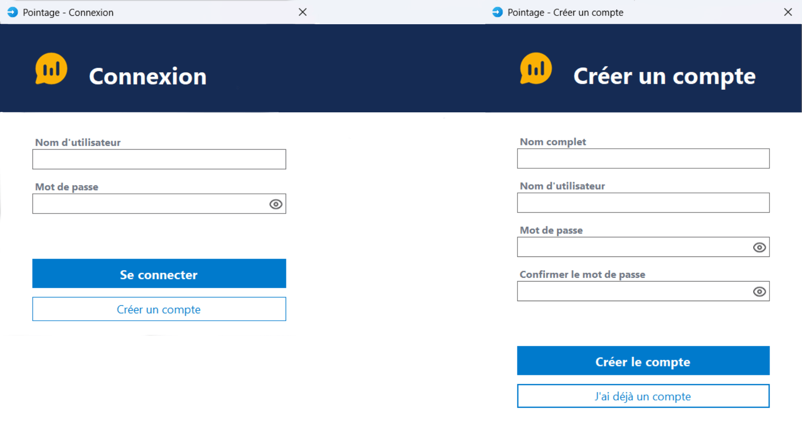
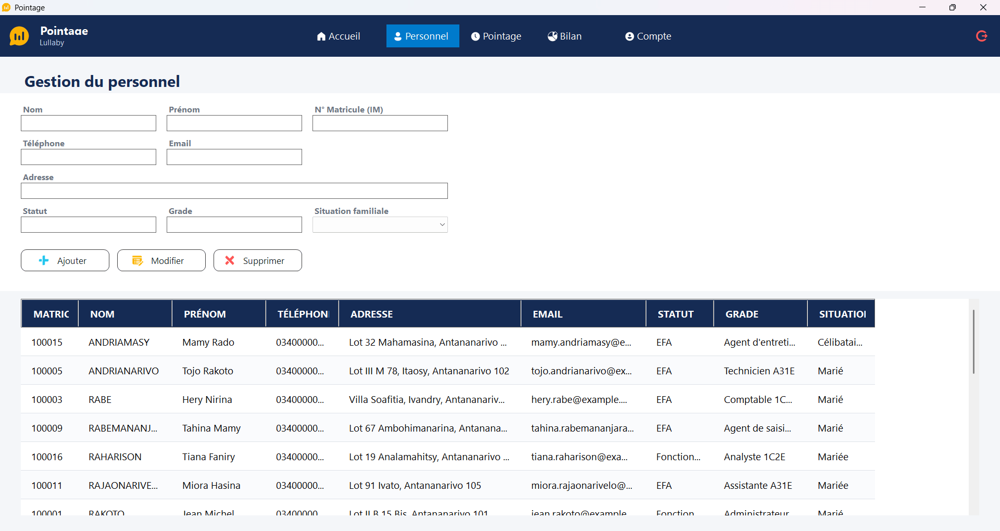
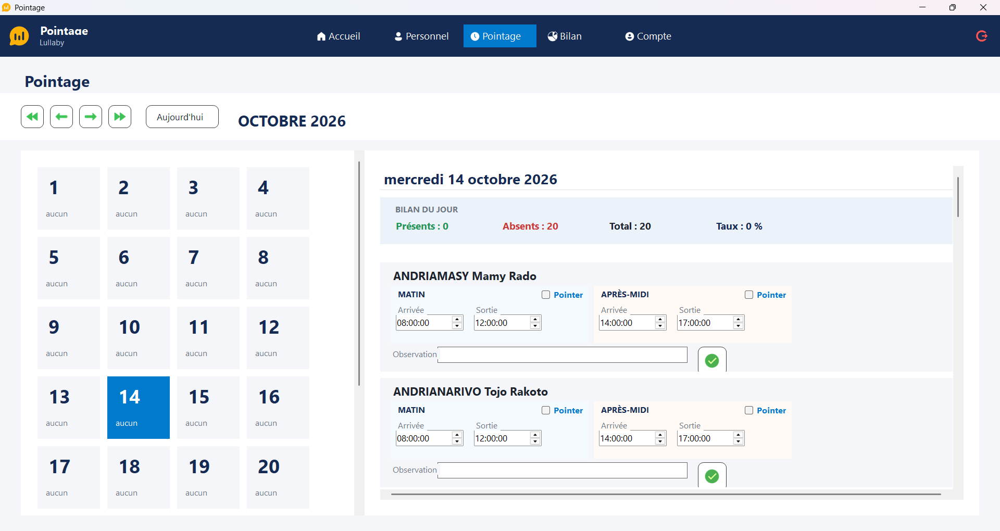
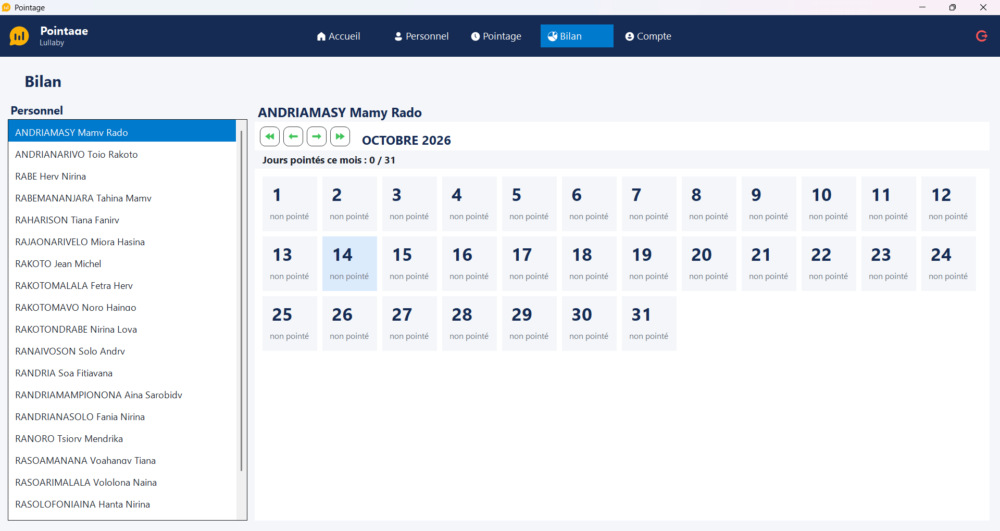

# APPLICATION DE POINTAGE DU PERSONNEL

APPLICATION DE GESTION DE POINTAGE DE PRÉSENCE DU PERSONNEL DÉVELOPPÉE EN **C# (.NET 8 / WINDOWS FORMS)** AVEC BASE DE DONNÉES **SQLITE** INTÉGRÉE.

---

## FONCTIONNALITÉS PRINCIPALES

- **GESTION DES UTILISATEURS & SÉCURITÉ** :
  - INSCRIPTION ET AUTHENTIFICATION SÉCURISÉE.
  - HACHAGE DES MOTS DE PASSE EN SHA-256 AVEC SALAGE (`SALT`).
- **GESTION DU PERSONNEL** :
  - AJOUT, MODIFICATION ET SUPPRESSION DES MEMBRES DU PERSONNEL.
- **GESTION DES POINTAGES (SUIVI QUOTIDIEN)** :
  - CALENDRIER MENSUEL INTERACTIF.
  - SAISIE DES HEURES D'ARRIVÉE ET DE SORTIE PAR PERSONNE.
  - AJOUT D'OBSERVATIONS PAR JOUR/PERSONNE.
  - RÉSUMÉ DU BILAN JOURNALIER (TAUX DE PRÉSENCE, TOTAL DES PRÉSENTS ET ABSENTS).
- **BILAN MENSUEL ET STATISTIQUES** :
  - VISUALISATION DES JOURS POINTÉS PAR MEMBRE DU PERSONNEL.
  - STATISTIQUES CONSOLIDÉES (HEURES TOTALES EFFECTUÉES, MOYENNE D'ARRIVÉE).
- **EXPORTATION DE DONNÉES** :
  - EXPORTATION COMPLÈTE DE LA BASE ET DES BILANS AU FORMAT **MICROSOFT EXCEL (`.XLSX`)** VIA CLOSEDXML.
- **INSTALLEUR WINDOWS** :
  - SCRIPT INNO SETUP INCLUS POUR GÉNÉRER UN FICHIER D'INSTALLATION (`POINTAGESETUP.EXE`).

---

## TECHNOLOGIES & BIBLIOTHÈQUES

- **LANGAGE** : C# (.NET 8.0 WINDOWS FORMS)
- **BASE DE DONNÉES** : SQLITE (`MICROSOFT.DATA.SQLITE` V10.0.12)
- **GESTION EXCEL** : `CLOSEDXML` (V0.105.1)
- **DÉPLOIEMENT / INSTALLEUR** : INNO SETUP 6

---

## APERÇU

### PAGE DE CONNEXION ET CRÉATION



### ACCUEIL


### PAGE DE PERSONNELS



### PAGE DE POINTAGE



### PAGE DE BILAN DES PERSONNELS



### PAGE DE PARAMETRES DE COMPTES


---

## STRUCTURE DU PROJET

```text
POINTAGE/
├── FORMS/                   # INTERFACES UTILISATEUR (WINFORMS)
│   ├── ACCUEILFORM.CS       # ÉCRAN D'ACCUEIL ET HORLOGE EN TEMPS RÉEL
│   ├── BILANFORM.CS         # VUE SYNTHÉTIQUE PAR EMPLOYÉ ET PAR MOIS
│   ├── LOGINFORM.CS         # ÉCRAN DE CONNEXION / CRÉATION DE COMPTE
│   ├── MAINFORM.CS          # FENÊTRE PRINCIPALE ET NAVIGATION
│   ├── PERSONNELFORM.CS     # FORMULAIRE CRUD DU PERSONNEL
│   └── POINTAGEFORM.CS      # INTERFACE DE POINTAGE QUOTIDIEN
├── MODELS/                  # MODÈLES DE DONNÉES (POCO)
│   ├── BILAN.CS             # DTO POUR LES BILANS
│   ├── PERSONNEL.CS         # MODÈLE PERSONNEL
│   ├── POINTAGE.CS          # MODÈLE ENREGISTREMENTPOINTAGE
│   └── UTILISATEUR.CS       # MODÈLE UTILISATEUR
├── SERVICES/                # LOGIQUE MÉTIER ET ACCÈS AUX DONNÉES
│   ├── DATABASE.CS          # GESTION SQLITE ET REQUÊTES SQL
│   ├── EXCELEXPORT.CS       # GÉNÉRATION DES FICHIERS EXCEL
│   ├── SECURITE.CS          # GÉNÉRATION DE SEL ET HACHAGE SHA-256
│   └── THEME.CS             # COULEURS, POLICES ET COMPOSANTS UI PERSONNALISÉS
├── IMAGES/                  # ICÔNES ET RESSOURCES GRAPHIQUES (PNG/ICO)
├── INSTALLER.ISS            # SCRIPT DE COMPILATION INNO SETUP
├── POINTAGE.CSPROJ          # FICHIER DE PROJET .NET
└── PROGRAM.CS               # POINT D'ENTRÉE DE L'APPLICATION
```
